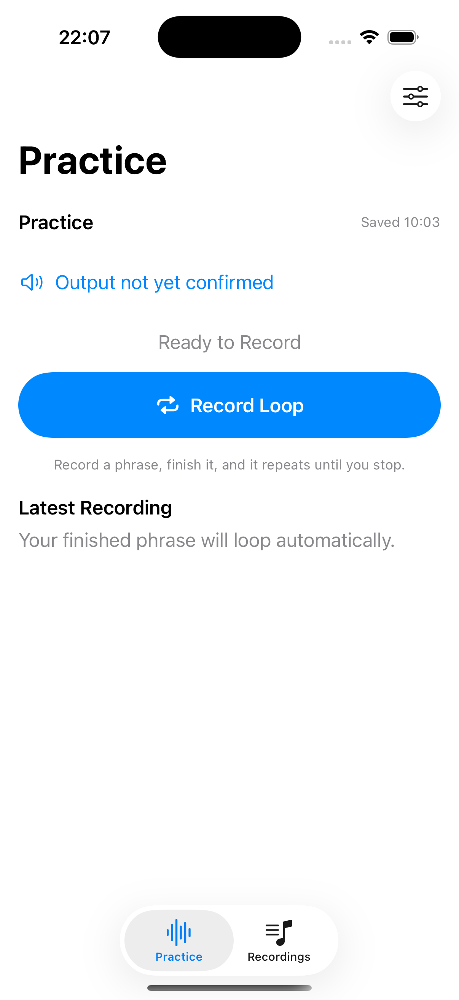

# Voice recording and single-take looping checkpoint

2026-10-10. Sources based on `0bee590` plus native voice, speaker policy and default-loop fixes. Direct Xcode 26.2 fallback; selected XcodeBuildMCP platform unavailable. Scheme BassPractice, iPhone 17 Pro/iOS 26.2 (`34AA36AD-2704-4759-A347-01A023DEB371`), DerivedData `/tmp/BassyVoiceFix-20261010`.

Full suite: 142 logical / 263 expanded cases passed, zero failures/skips (`/tmp/BassyLoopReadFix-full.xcresult`). Signed device build/installation/launch succeeded. User confirmed clear voice and both loop actions. [Current findings and limits](../../plan/features/2026-10-10-recording-quality-and-monitoring.md).

Installed from the tested simulator product after boot readiness. Image accepted by repository boot-screen checker and visually inspected without clipping. Demonstrates empty Practice/Record Loop layout; it does not show active recording/playback. Physical audio confirmation comes from user testing, and repeated render/Stop behavior from native tests. Later loader-only correction and diagnostic cleanup do not change this layout. Final PR cleanup regression results are recorded in the current findings note.

PR cleanup rerun: 142 logical / 263 expanded cases passed with no failures/skips (`/tmp/BassyLoopPR-final.xcresult`). Raw capture instrumentation removed; implementation comments and the plan link the observed failures to concrete safeguards/tests. Local signing project changes are preserved outside the commit.
